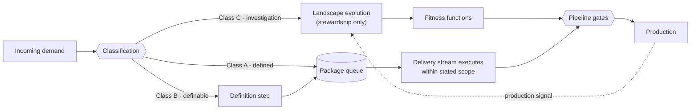

# Stewardship & Delivery Streams

A working structure for a large enterprise in which a team that defines its own work has to operate alongside a delivery group that executes what is explicitly defined — while the application landscape keeps evolving.

The documents here use the working terms *core team* and *delivery group*. They describe the same two halves this project names **stewardship** (holds the context, the access and the authority to change the landscape) and **delivery streams** (execute classified, fully defined work).

## The idea

**Definition completeness is the interface, and it is the stewardship team's product.**

If delivery executes exactly the envelope it is given, the envelope determines the outcome, and a shortfall in delivery is a shortfall in the envelope. The structure stops trying to make a delivery group exceed the envelope and instead makes the envelope equal the correct outcome. If the minimum is sufficient, minimum-effort behaviour stops being a problem.

Everything else follows from that:

- Ambiguity never crosses the boundary.
- The minimum is made identical to the correct outcome, through acceptance expressed as pre-written failing tests.
- Rules are executable fitness functions in the pipeline, not prose in a documentation maze.
- Information is pulled on a schedule rather than waiting for anyone to volunteer it.
- Accountability is defined so precisely that the question "whose fault was it?" does not arise.



## The main elements

| Element | In one line |
|---|---|
| **Work classification** | Class A (defined), B (definable), C (investigation). Work crosses the boundary only as Class A — no exceptions, under any schedule pressure. |
| **The work package** | A mandatory structure; a package with an unfillable field is not Class A and goes back to definition. |
| **Acceptance scaffolding** | Criteria that two different people can verify independently, climbing a ladder towards failing tests written before the work starts. |
| **Executable constraints** | Architectural and compliance rules as fitness functions in the pipeline. A compliance question is investigated once and encoded as a gate. |
| **Protected landscape capacity** | Committed work with its own backlog, measured by the proportion of work that can be routed as Class A. |
| **Pulled interface** | A named person asks specific people specific questions on a fixed cadence. Blocking is encouraged, but the design does not depend on it. |
| **Bilateral working agreement** | Both sides' accountabilities written down; the decisive element is the explicit *not accountable for* list. |
| **Baseline first** | Record how the current arrangement behaves before anything is announced, then judge one stream against its own prior numbers. |

## Design decisions that are easy to undo by accident

1. **Information is pulled, not pushed.** An open channel with a response SLA fails when nothing is volunteered. What is optimised is not round-trip time but silent assumptions.
2. **The boundary is dispositional, not geographic.** The design sorts by work class, never by location or employer. "Class A" must not become shorthand for "work we send over there"; the structure is worth adopting even if an offshore arrangement ends.
3. **The stewardship team does not exist yet and has to be formed.** Four to six people from the team already working this way, with authority to refuse a package, access to production signal and a named owner for classification on day one. The conversation about what it will *not* be measured on happens before it starts.

## What this is not

- Not a reorganisation. No reporting line, desk or employer changes.
- Not better tickets. The product is the landscape and the scaffolding around it.
- Not more process, and not a transformation programme. It starts on one stream and is judged on that stream's own numbers.
- Not contingent on anyone else changing. It works with the arrangement that exists.
- Not anti-agile, and not a position for or against offshoring.

## Contents

| File | Purpose |
|---|---|
| [Working structure - core and delivery group.md](<Working structure - core and delivery group.md>) | The operating model: principle, classification, packages, constraints, interface, working agreement, baseline, measures, costs, team formation, sequence. |
| [Two profiles in a software team.md](<Two profiles in a software team.md>) | Practitioner account of the two ways of working, each with strengths and costs, and what happens when both exist in one organisation. |
| [Talk deck - Taylorism and Druckerism.md](<Talk deck - Taylorism and Druckerism.md>) | Conference talk deck (Marp). Currently out of date — see `CLAUDE.md`. |
| [reference/Taylorism.md](reference/Taylorism.md) | Scientific management: neutral and historical. |
| [reference/Druckerism.md](reference/Druckerism.md) | Management by objectives and knowledge work: neutral and historical. |
| [reference/References.md](reference/References.md) | Framings considered and why each was or was not adopted. |
| [reference/Cases.md](reference/Cases.md) | Publicly verifiable cases of nearshore arrangements outside tech. |
| [CLAUDE.md](CLAUDE.md) | Project conventions and register for working on these documents. |

## Reading order

1. *What this is* and *The organising principle* in the working structure.
2. Sections 1, 5 and 6 of the working structure: classification, the interface and the working agreement.
3. Sections 7 and 14: the baseline and the sequence, for what to do first.
4. *Two profiles in a software team* for the reasoning behind the design.

## Working with the notes

The notes are Obsidian markdown with `[[wikilinks]]` and Mermaid diagrams. Mermaid renders in Obsidian and on GitHub, but not in Marp without extra setup; export diagrams as images before running `marp-cli`.

```sh
npx @marp-team/marp-cli@latest "Talk deck - Taylorism and Druckerism.md" --pdf
```

## Licence

See [LICENSE](LICENSE).
