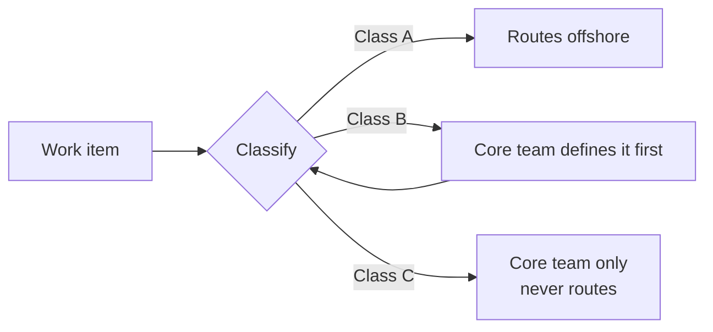
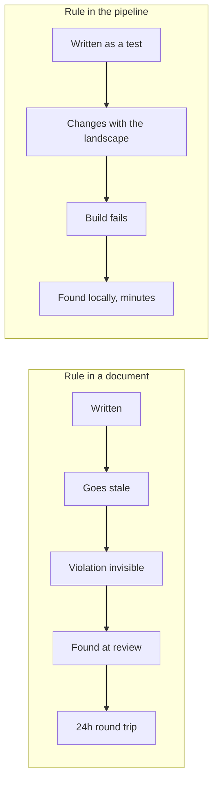
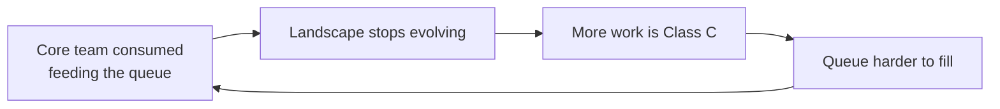
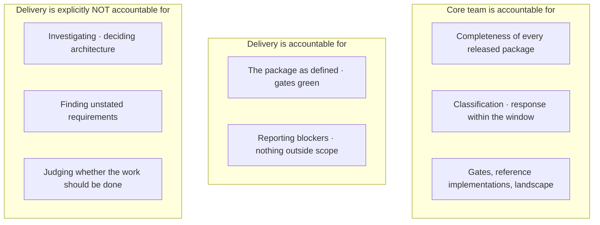

<!--
TALK: "Your team was designed in 1911"
Target: 45 minutes speaking + 5 minutes Q&A.
Audience: software developers.

TIMING ANCHORS
  00:00  Part 0  - Opening                     3 min
  00:03  Part 1  - Taylor                      5 min
  00:08  Part 2  - Drucker                     5 min
  00:13  Part 3  - Your daily life             9 min
  00:22  Part 4  - Adding distance             5 min
  00:27  Part 5  - The structure              16 min
  00:43  Part 6  - Close                       2 min

EXPORT
  npx @marp-team/marp-cli@latest "Talk deck - Taylorism and Druckerism.md" --pdf
  npx @marp-team/marp-cli@latest "Talk deck - Taylorism and Druckerism.md" --pptx
  Mermaid does not render in Marp by default. Either present from Obsidian Slides,
  or export the three diagrams as images and swap them in before the Marp export.
-->

# Your team was designed in 1911

### And nobody asked you

 

Taylorism, Druckerism, and why your sprint feels the way it does

<!--
Open cold. No agenda slide.

"Almost everything about how your team works - the ticket, the estimate, the
standup, who gets to decide what gets built - was settled in an argument that
happened between 1911 and 1954. You weren't in that argument. Most of your
managers don't know it happened."

Set the promise: by the end you will be able to walk into any team and tell
which of two systems it is running, within about a day. And you'll know what
to do about it.
-->

---

## Two men

**Frederick Winslow Taylor** — 1856-1915
Machinist. Stopwatch. *The Principles of Scientific Management*, 1911.

**Peter Drucker** — 1909-2005
Journalist. Forty books. *The Practice of Management*, 1954.

 

They are both still in the room with you every single day.

<!--
Keep this to 30 seconds. Names and dates only, no biography yet.

Don't say "and today we'll compare them" - just move.
-->

---

## What this talk is not

- Not "agile bad, something else good"
- Not a methodology
- Not a pitch for or against offshoring
- Not about anyone being lazy or incapable

 

It is about **where the thinking happens**, and what that does to the code.

<!--
This slide earns you permission for the back half. Say it plainly.

Especially the fourth bullet - we will talk about offshore delivery later and
people will be listening for whether you are going to insult someone. Tell
them now that you are not, then keep the promise.
-->

---

<!-- _class: lead -->

# Part 1
## Taylor

<!-- 00:03 - five minutes. Do not get stuck here. The history is setup, not the talk. -->

---

## The problem he was solving

1900. Factories growing faster than anyone can manage them.

Nobody knows how long anything takes.

Workers deliberately work slowly — Taylor calls it **systematic soldiering**.

<!--
Crucial point and it takes ten seconds: soldiering was RATIONAL.

Piece rate. Produce more, management cuts the rate per piece. You end up
doing more work for the same money and you put your mate out of a job. So
the group quietly agrees on a pace.

Management suspects it and can never prove it - because management does not
actually know how long the work takes.

Any developer who has ever padded an estimate knows exactly what this is.
Pause there. That is the laugh and the hook.
-->

---

## His insight

> How long a task takes is not an opinion.
> It is a measurable fact.

 

Break the work into elements. Time each element. Throw away the waste.
Reassemble.

**There is one best way.**

<!--
This is genuinely a good idea. Don't sneer at it. Measurement beat folklore,
and that was progress.

The "one best way" is the load-bearing assumption. Flag it now, come back to
it later - because it is the assumption that breaks in software.
-->

---

## The four principles

1. Develop a **science** for each element of the work
2. Scientifically **select and train** the worker
3. **Cooperate** to ensure the method is followed
4. **Divide the work**: management plans, workers execute

<!--
Read 1-3 fast. Land on 4.
-->

---

## Only the fourth one matters

> "All possible brain work should be removed from the shop and centred in
> the planning or laying-out department."
>
> — Taylor, *Shop Management*, 1903

 

**Separation of conception from execution.**

<!--
This is the whole talk in one quote. Let it sit for three seconds.

Everything else - the stopwatch, the piece rate, the instruction card - is
implementation detail. THIS is Taylorism: someone over here decides, someone
over there does.
-->

---

## The machinery

| Taylor built | You have |
|---|---|
| Time study | Estimation |
| The instruction card | The ticket |
| Standard times | Story points |
| The planning department | Architecture / analysis |
| Inspection at the end | QA as a stage |
| Differential piece rate | Sprint commitment |

<!--
Do not explain each row. Let them read. Say one sentence:

"I'm going to come back to this table and it's going to be less funny the
second time."

Move on quickly - the discomfort should arrive later, not here.
-->

---

## Functional foremanship

Taylor split the foreman into **eight specialists**.

Each worker reported to all of them. Each one authoritative in a narrow lane.

 

It was the one part of his system almost nobody adopted.

<!--
Set this up now, pay it off in Part 3. Don't make the joke yet.
-->

---

## It did not go quietly

**1911** — strike at Watertown Arsenal over stopwatch timing
**1912** — Taylor testifies before a special committee of Congress
**1915** — Congress bans stopwatch timing in government arsenals

 

Taylor, to his death: *you are all doing it wrong.*

<!--
Worth being fair to him. He insisted the method had to be developed WITH the
workers, that wages had to rise, and that management had to give up its
guesswork too - he called it a "mental revolution".

What organisations actually adopted was the stopwatch and the standard,
without the mental revolution. That pattern is going to repeat.
-->

---

<!-- _class: lead -->

# Part 2
## Drucker

<!-- 00:08 - five minutes. Same discipline. History is setup. -->

---

## A different starting point

Taylor starts with **the task** and reasons out to the organisation.

Drucker starts with **the organisation as a human institution** and reasons in
to the task.

 

Nearly everything else follows from that.

<!--
One sentence of biography, maximum: 1943, General Motors invites him in for
18 months, he writes a book treating the corporation as a society rather than
a machine, GM hates it, it makes his career.
-->

---

## 1959: he names us

# Knowledge worker

<!--
Big slide, one word. Let it land.

Then the definition - and insist on this, because everyone thinks it means
"has a degree" or "wears a lanyard":
-->

---

## The definition is structural

> A knowledge worker **knows more about their own work than anyone else in
> the organisation** — including their boss.

 

Not "educated". Not "senior". Not "white collar".

<!--
This single sentence demolishes Taylor's fourth principle. If the person
doing the work knows the most about it, there is nobody upstairs qualified to
write the instruction card.

For developers this is not aspirational, it is just a description. Nobody in
your management chain can tell you why that query is slow.
-->

---

## What follows from it

- You **own the means of production** — it's between your ears, and it walks out every evening
- You must be **self-managing**, not because it's nice, but because direction from above cannot be informed enough
- You are an **asset**, not a cost
- The organisation needs you more than you need it

<!--
"Asset not cost" - the test is never what the company says, it's what happens
in a bad quarter. Costs get cut. Assets get protected.
-->

---

## The parts that are actually useful

**Effectiveness over efficiency** — doing the right things beats doing things right

**Management by objectives *and self-control*** — the second half is the point: the feedback goes to the person who can act on it

**Systematic abandonment** — *"if we were not already doing this, would we start it today?"*

**Feedback analysis** — write down what you expect to happen, then check

<!--
Spend most of your time on self-control. The measurement reaching the DOER,
fast enough to correct themselves. That is the mechanism. Everything else in
Drucker is downstream of it.

Abandonment: ask the room when they last deliberately deleted a feature.
Usually silence.
-->

---

## Two things he never said

> "Culture eats strategy for breakfast"

> "What gets measured gets managed"

 

Neither appears anywhere in his work.
The second traces to a 1956 paper **warning** about measurement.

<!--
Developers love this. Thirty seconds, get the laugh, move.

But make the serious point: the second one is used every day to justify
exactly the thing Drucker was most careful about - counting the output of
knowledge work.
-->

---

<!-- _class: lead -->

# Part 3
## Your daily life

<!-- 00:13 - nine minutes. This is the part they came for even though they don't know it yet. -->

---

## Here is the uncomfortable bit

Agile adopted **Drucker's vocabulary**.

 

Most organisations kept **Taylor's structure**.

<!--
Slow down. This is the thesis of the talk.

Autonomy. Empowerment. Self-organising. Ownership. Squads. Every word in the
manifesto is Drucker. And underneath it, in a very large number of companies,
the structure never moved an inch.
-->

---

## Translate it back

**Story points** → time study
**Velocity** → output per period
**The backlog** → a queue of instruction cards
**Refinement** → work study
**Definition of Ready** → the gate on Taylor's planning department
**Sprint commitment** → the differential piece rate, minus the bonus

<!--
This is the slide people photograph. Give it room.

Be fair: none of these are evil. Time study was an improvement on guessing.
The problem is not the tool, it's that the tool assumes work decomposes into
independent, stable, countable elements - and then we apply it to work where
that is not true.
-->

---

## Remember functional foremanship?

Your **scrum master** owns process
Your **tech lead** owns method
Your **line manager** owns your performance
Your **delivery manager** owns the schedule
Your **product owner** owns scope

 

Five authorities. None of them accountable for the outcome.

<!--
Here's the payoff. Taylor invented this in 1903, found it didn't work, and it
was the one piece of his system that got dropped.

We rebuilt it. Accidentally. With better job titles.
-->

---

## The test that takes one question

# Who writes the ticket?
# Who does the work?

 

Different people, and the writer is more senior?

**That is Taylor's fourth principle, in your Jira.**

<!--
Let the room sit in it. Many of them have never framed it this way and the
recognition is physical.
-->

---

## A field guide: the Taylorist team

- Organised around a **layer or a phase**, not an outcome
- Work arrives **already solved** — the ticket describes the solution
- Method lives in **documents and roles above the team**
- Measures **units produced per period**
- **Utilisation is tracked**; idle time needs explaining
- QA is a **stage**; people say "throw it over the wall" without irony
- Improvement is a **programme** with a name and a rollout

<!--
Present it as something you observe, not something you judge. "If I sat in
your team for a week and was not allowed to ask what anyone believes about
management, this is what I would be looking at."
-->

---

## The words you'd hear

> resource · FTE · capacity · ramp-up · allocation
> utilisation · velocity · throughput
> hand-off · sign-off · gate · out of scope
> **"the business"**
> **"that's not my ticket"**

<!--
People are counted and graded, not named. "We need two more mediors" rather
than "we need someone who understands the payment flow".
-->

---

## A field guide: the Druckerian team

- Organised around an **outcome someone outside experiences**
- Work arrives as a **problem**, not a solution
- The team **defines the task** — out loud, before doing it
- Measures **what changed outside the team**
- Feedback goes to **the person who can act on it**
- Quality is a property of the work **as made** — you build it, you carry the pager
- Improvement is **continuous, local, unannounced**

<!--
Nobody tracks individual utilisation. Slack in the week is not an anomaly
requiring an explanation.
-->

---

## The words you'd hear

> outcome · customer · the problem we're solving
> **"what are we actually trying to do here?"**
> **"what would we need to see to know we were wrong?"**
> **"would we start this today?"**
> *people by name, and by what they're good at*

<!--
The absences matter as much as what's there. No "resource". No "the business"
as a distant actor somewhere else.
-->

---

## Four signals that cannot be faked

1. **Who defines the task?**
2. **Where does the method live?**
3. **Which direction does measurement flow?**
4. **What happens when someone says this shouldn't be built?**

<!--
This is the most useful slide in the deck and you should say so.

Any organisation can adopt every word in the Drucker column in a single
quarter. Nobody can fake these four. Ask them in an interview. Ask them on
Monday.
-->

---

<!-- _class: lead -->

# Part 4
## Now add 6000 kilometres

<!-- 00:22 - five minutes. Careful register. No blame, structural only. -->

---

## The standard arrangement

A **core team** onshore: architects, analysts, senior developers.

A **delivery team** offshore or nearshore.

The core team decides what needs to be done. The delivery team does it.

 

Everyone describes this as "a hybrid model".

<!--
Describe it completely neutrally. Let them nod along.
-->

---

## It isn't a hybrid

# You drew Taylor's fourth principle
# on a map

<!--
Conception here, execution there, with a time zone in between.

That might still be the right decision. But it should be made as a decision,
not stumbled into while believing you're running something modern.
-->

---

## And it does not leave the core team Druckerian either

Their output becomes **specifications for other people**.

They stop touching the system. Their model goes stale.

The specs get worse. Delivery follows them faithfully. Quality drops.

 

The diagnosis is always: ***the specs weren't detailed enough.***

<!--
This loop is the most reliably observed failure in the entire model. Specs
get longer, authoring becomes the bottleneck, and the core team wakes up one
morning as the architecture function from the first field guide - writing
documents about a system they no longer feel.

You don't get one Drucker team and one Taylor team. You get two Taylor teams,
one of which has better chairs.
-->

---

## Taylor's preconditions

| He needed | Software gives you |
|---|---|
| A stable method worth writing down | A method that changes weekly |
| Independent, decomposable elements | Elements coupled through the design |
| Output in uniform countable units | Quality *is* the output |
| Defects visible at inspection | Design defects, invisible at review |
| The foreman ten metres away | A 24-hour round trip per question |

<!--
That last row is the one Taylor never had to solve.

Under a spec-driven handoff, every ambiguity costs a day. So the locally
rational move at 2pm is to guess rather than ask. And the model has no
mechanism for catching a silent assumption - you find out in integration,
three weeks later.
-->

---

## So here's the honest position

Some delivery groups deliver **exactly the defined envelope**, and nothing
outside it.

Ambiguity in, nothing out.

 

You can spend three years trying to change that.
Or you can **design for it**.

<!--
Register check. Say this without any edge in your voice.

This is not a claim about anybody's ability or character. It is a statement
about what a given arrangement - contract, incentives, access, tenure,
authority - can be asked to produce. Put anyone on a time-and-materials
contract, measured on hours booked, with no production access and no mandate
to say no, and you will get the same behaviour.

The rest of the talk assumes you've tried, and you're designing for the
system you actually have.
-->

---

<!-- _class: lead -->

# Part 5
## The structure

<!-- 00:27 - sixteen minutes. This is the deliverable. Slow down and be concrete. -->

---

## Reframe

If a group delivers exactly the envelope they're given…

 

…then the **envelope** determines the outcome.

 

**A shortfall in delivery is a defect in the envelope.**

<!--
This is not generosity. It is the only framing that produces a working
feedback loop, because it puts the defect in the hands of the party that can
actually fix it.

It also removes the conversation that poisons these arrangements: whose fault
was it.
-->

---

## The one move

# Stop fighting minimum effort
# Make the minimum sufficient

<!--
You cannot make people exceed the envelope. You CAN make the envelope equal
the correct outcome.

Everything from here is mechanics for doing that.
-->

---

## Three classes of work

**Class A — Defined**
Solution known · pattern exists · blast radius named · acceptance expressible as tests

**Class B — Definable**
Outcome understood, solution not yet worked out, resolvable in bounded time

**Class C — Investigation**
Outcome, solution or blast radius unknown

<!--
Classification is the scarcest skill in the whole arrangement, and it appears
in nobody's job description by default. Name it. Make someone answerable for
it.
-->

---

## The routing rule

**No exceptions. Not for deadlines. Not for anything.**

<!--
Every single story you have ever heard about offshore delivery failing traces
back to a package that was not Class A when it was sent.

Routing B or C across the boundary fails three ways at once: no usable
output, a schedule that slips late and invisibly, and a conflict where
somebody gets blamed for not doing a thing they were never asked to do.
-->

---

## The work package

Every field mandatory:

**Outcome** · **Scope** · **Out of scope** · **Reference implementation**
**Acceptance** · **Non-functionals** · **When blocked**

 

A field you cannot fill means **it is not Class A**.

<!--
That is the gate doing its job, not an inconvenience.

"Reference implementation" means a link to real code in the repo that
compiles and runs. Not a prose description of the pattern. Code.
-->

---

## Acceptance

# Pre-written failing tests

### "Make these pass. Change nothing outside the stated scope."

<!--
This is the single highest-leverage thing in the talk. Slow all the way down.
-->

---

## Why that one change does so much

- **Unambiguous** — no interpretation required
- **Self-verifying** — they know they're done without asking
- **Survives the time zone** — the answer exists when the question arrives
- **Minimum effort and correct outcome become the same thing**

 

There is no gap left for minimum effort to fall into.

<!--
You are already doing the thinking needed to write acceptance criteria.
Writing them as tests instead of bullet points costs a bit more per package
and deletes an entire category of round trip, rework and argument.

If a package cannot be expressed this way, that is strong evidence it was
never Class A.

Java shop: JUnit, slice tests, Testcontainers for anything touching the
database, contract tests generated from OpenAPI for anything crossing a
service boundary.
-->

---

## Documentation rots silently

The only signal a document is wrong is **someone reporting confusion**.
Which, by premise, will not happen.

<!--
This is why "we'll write better documentation" never works as the answer. It
puts the detection mechanism in the hands of the party least able to use it.
-->

---

## Rules that enforce themselves

- **ArchUnit** — module boundaries, dependency direction, forbidden imports
- **Contract tests** from OpenAPI — no silent interface changes
- **Flyway conventions** — naming, reversibility, forbidden operations
- **Spotless / Checkstyle** — style is never a review conversation
- **Encoded regulatory rules** — audit trail, PII, residency, retention

<!--
ArchUnit is the highest-value item on this list by a distance. It converts
architectural intent from a document nobody reads into a test that fails.

In a regulated environment the last bullet is the one that should keep people
awake. Those are rules you genuinely cannot afford to leave to somebody's
recollection of a wiki page from March.
-->

---

## And this solves the real conflict

Taylorism needs a **stable** method.
Your core team's job is to **change** the method.

 

Prose can't do both. **Executable constraints can.**

Change the fitness function → the rule propagates to everyone's pipeline, today.

<!--
This is the intellectual centre of the solution and it's worth naming as
such. The reason "excellent documentation" strangles evolution is that the
better the docs get, the more expensive change becomes. Executable rules
migrate. Prose just rots.
-->

---

## Protect the landscape work

The thing that kills this structure is not conflict.

It is the core team being **entirely consumed feeding the queue**.

<!--
And it's slow. Nobody notices for a year, and by then it's very hard to
reverse.
-->

---

## The spiral

Run it backwards and it's the flywheel: landscape evolves → **more work becomes Class A** → less authoring per unit delivered → capacity freed.

<!--
This is also what gives the architecture work a direction. You are not
improving the landscape in the abstract. You are improving it so that a
larger share of future work can be routed.

Which gives you the single best metric in the whole arrangement - coming up
in two slides.
-->

---

## Two mechanisms

**A defended capacity split**
Landscape evolution is committed work with its own backlog. Not what happens if there's time left.

**A WIP cap on authoring**
Maximum packages per period. When you hit it, **the queue runs dry.**

<!--
Agree the dry queue with management IN ADVANCE, because the first time it
happens it will look like failure. It is the mechanism working. The
alternative is packages going out that aren't Class A, under pressure, which
costs more and surfaces later.
-->

---

## The capacity ceiling

Offshore throughput is a function of **core-team authoring bandwidth**.

Below the ceiling: headcount becomes throughput.
Above the ceiling: headcount becomes **queue** — and pressure to ship packages that aren't Class A.

 

Measure the ratio. Publish it.

<!--
Then when the proposal arrives to add fifteen people, your answer is
arithmetic instead of opinion. That volume needs a proportional increase in
authoring capacity, or those people will wait.

This is the slide that saves you an argument you would otherwise lose.
-->

---

## The working agreement

<!--
The bottom box is the one that prevents conflict, and it's the one nobody
ever writes down.

Once it exists, "they should have noticed" and "they did the bare minimum"
stop being available as explanations - because nobody was asked to notice.
You have removed the unmet expectation from circulation.
-->

---

## Blocking is correct behaviour

A gap is found → **stop and report it**. Immediately.

- One **named responder** on rota, response in **hours**
- Every block produces **two** outputs: the answer, and a change to the template, the reference implementation or a fitness function

<!--
Say the second part twice. Without the second output the same question
arrives every month and both sides quietly conclude the other one isn't
learning.

And you have to reinforce "stopping is correct" the first several times it
happens, because the default assumption will be that stopping is failure.
-->

---

## Defect routing

When something escapes, exactly one question:

# Was it covered by the package as written?

**No** → specification gap → logged against *the package*
**Yes** → implementation error → logged against *delivery*

<!--
Spec gaps are logged against the package, never against the person who
followed it.

This keeps the post-mortem factual, and it quietly builds the dataset that
tells you whether your definition quality is improving.
-->

---

## What to measure

- **Package completeness defects** — gaps found per package *(core team's metric)*
- **First-time-pass rate** at review
- **Round trips** and **blocked time**
- **Escapes by category** — spec gap vs implementation error
- **Proportion of work classifiable as Class A** ← *the one that matters*

<!--
Measure the interface, not the people.

That last one is the health indicator for the entire arrangement. If it isn't
rising over time, your architecture work is not paying off, and you now know
that in month four rather than year three.
-->

---

## Say the costs out loud

- Capacity is **capped**; it doesn't scale by hiring offshore
- The core team is on the **critical path for everything** — key-person risk
- The capability gap **widens**, structurally
- **Nobody moves between the groups** — if that's intended, make it explicit
- The queue will sometimes be **empty**

<!--
Make these decisions rather than surprises. Every one of them will otherwise
arrive as an accusation in eighteen months.

The fourth is worth a sentence of honesty on stage: a structure where one
population permanently cannot advance into the other is a real thing to
choose, and even a token rotation path changes what it means.
-->

---

## Where to start Monday

1. Write the working agreement — **both lists**
2. Define the three classes; make classification someone's job
3. Run ten packages through the template; record what was missing
4. **ArchUnit** and the regulatory checks into the pipeline
5. One reference implementation that is real and deployed
6. Acceptance as failing tests — **one stream first**, compare round trips

<!--
Emphasise six. Don't boil the ocean. Pick one stream, do acceptance as tests
for a month, and measure round trips against everything else. That's your
internal business case.
-->

---

<!-- _class: lead -->

# Part 6
## Close

<!-- 00:43 - two minutes. Land it and stop. -->

---

## What this was really about

Taylor was right that **measurement beats folklore**.

Drucker was right that **the person doing the work knows the most about it**.

 

The failure is not picking one.
It's **saying one and building the other**.

<!--
Be fair to both of them here. The talk should not end as a hit piece on
Taylor. His conditions were real and his method fit them.
-->

---

## Take these four home

1. **Who defines the task?**
2. **Where does the method live?**
3. **Which direction does measurement flow?**
4. **What happens when someone says this shouldn't be built?**

 

Ask them about your own team on the way back to your desk.

<!--
Callback to Part 3. Same slide, deliberately.
-->

---

# Your team was designed in 1911

### You can redesign it

 
 

*Questions*

<!--
Stop talking. Don't add a thank-you slide.

LIKELY QUESTIONS, and the short answers:

"Isn't this just waterfall?"
  No - the loop is short and the definition is executable. Waterfall defines
  everything once, up front, in prose. This defines one package at a time, as
  tests, and treats a wrong definition as a defect with a feedback path.

"Why not just make the offshore team autonomous?"
  Try it. Named individual, bounded area, real decision rights, production
  signal, and a conversation with their employer so it shows up in THEIR
  appraisal. Six months. If it works you've found the lever; if it doesn't
  you've converted a belief into evidence.

"Our architects would never write tests."
  Then they are not producing the thing that determines the outcome, and the
  arrangement will cost you more than it saves.

"Isn't pre-writing tests just doing the work twice?"
  It's doing the thinking once, in the form that travels. You were already
  writing acceptance criteria. This is the same thinking in a format that
  can't be misread and verifies itself.

"How big should the core team be?"
  Wrong question - measure the authoring ratio and let the arithmetic answer
  it.
-->
