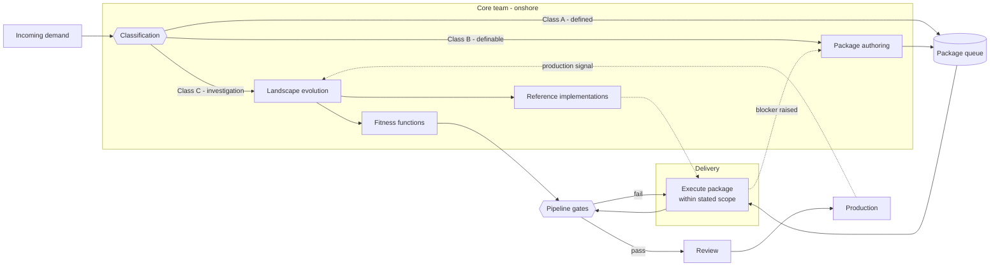
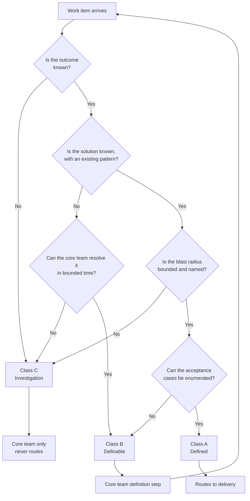
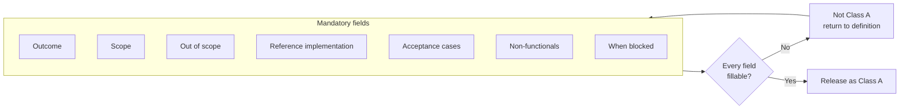
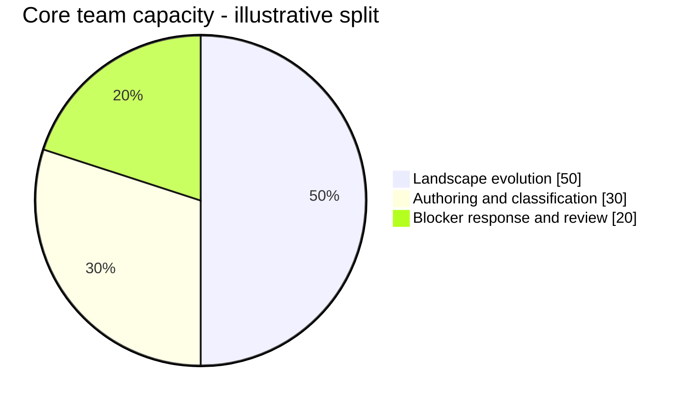
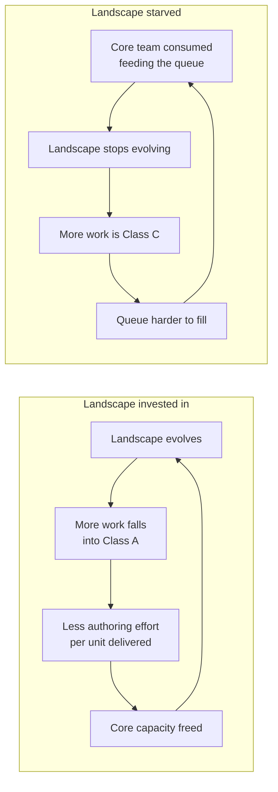
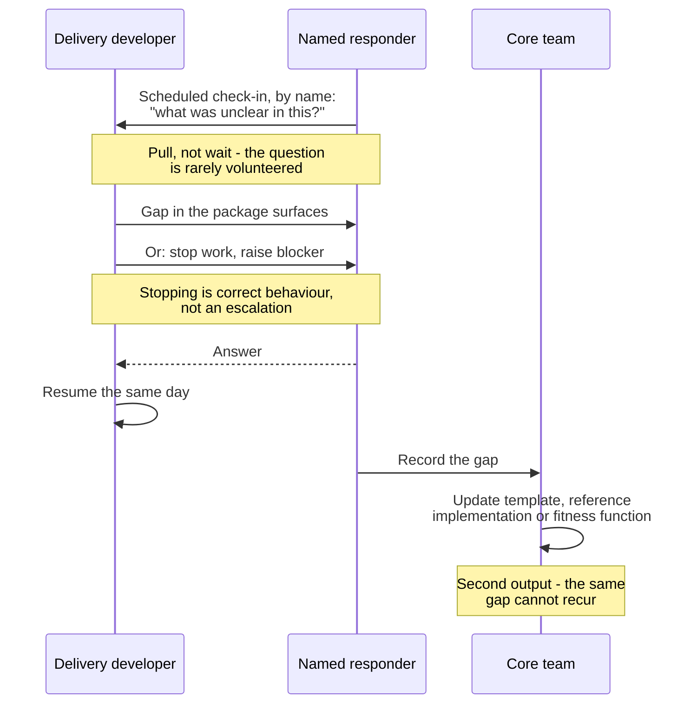
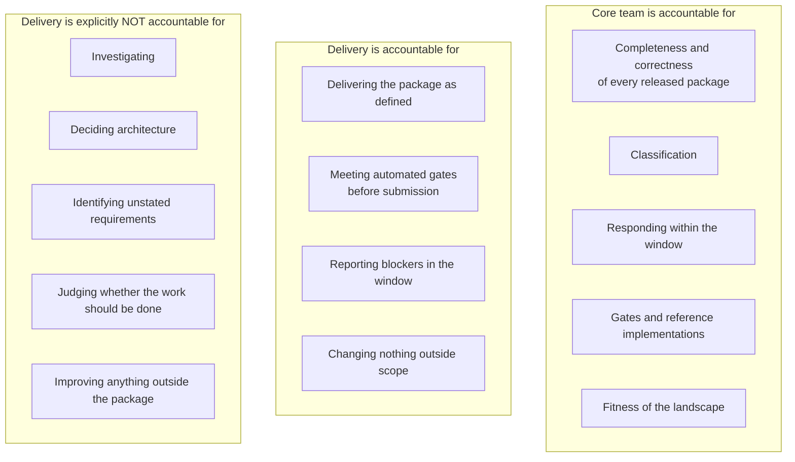
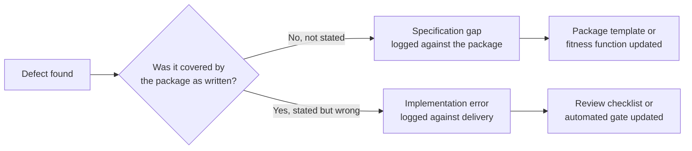
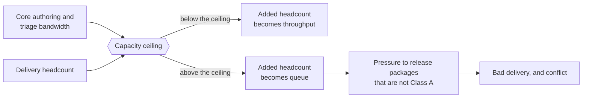

## What this is

A working structure for a large enterprise that runs a [[Druckerism]]-capable core team alongside a delivery group that operates on [[Taylorism]] lines, where the application landscape has to keep evolving at the same time.

The delivery group is typically offshore, nearshore or AI, but the structure does not depend on that — see "Where the boundary actually falls" below.

The first action it asks for is not a change at all: record a baseline of how the current arrangement behaves, before anything is announced. Section 7 covers it, and it is step zero in section 14.

It is built to do two things at once: keep the landscape evolving, and keep the delivery group productive without generating conflict. Those pull against each other, and most of the design below exists to manage that tension explicitly rather than letting it surface as friction between people.

## What this is not

The short description invites two misreadings, and both are fatal to it. It sounds like splitting the team, and it sounds like writing better tickets — one heard as a reorganisation, the other as a documentation exercise. A layer of cost, proposed by people who want more time to write things down.

Neither is what this is.

- **Not a reorganisation.** No reporting line changes. Nobody moves desk, changes manager or changes employer. What changes is how work is classified and defined before it is handed over.
- **Not better tickets.** The ticket is a by-product. The product is the landscape and the scaffolding around it — the boundaries, the reference implementations, the automated gates. The organisation already has extensive documentation and it has not helped.
- **Not more process.** On balance it removes steps: the re-explaining, the rework loop, the escalation, the meeting about who was responsible.
- **Not a transformation programme.** No name, no rollout, no training. It starts on one stream and is judged on that stream's own numbers.
- **Not contingent on anyone else changing.** It requires no renegotiation with the supplier, no different hiring, and no change in anyone's willingness to work differently. That is the design intent: it works with the arrangement that exists.

## Stated assumptions

These are premises, not findings. They are written down so that anyone reading the design knows what it rests on, and so that the design can be revisited if a premise changes.

1. The delivery group delivers what is explicitly defined, and does not deliver what is not explicitly defined.
2. Work that requires investigation produces no usable result when routed to them.
3. This will not change within the planning horizon. Opportunities to grow into broader responsibility have been offered over a period of years and were not taken up.
4. **Nothing is volunteered.** Opinions, concerns and questions appear on direct solicitation and essentially never otherwise — including in meetings convened to collect them. Ask a specific person a specific question and you get a considered answer.
5. **The posture is disengagement, not inability.** There is real competence within the defined envelope and real care about craft. What is absent is any wish to participate beyond the ticket.
6. **Distance is not the obstacle.** The time difference is about an hour and questions can be answered the same morning. They are still not asked; not wanting to bother anyone is the stated reason. Any fix that works by shortening the loop will not work here.
7. **Failure produces attribution rather than investigation.** When something goes wrong the conversation moves to whose fault it was, and nobody involved says they were wrong. This is structural: with no shared record of what was supposed to happen, there is nothing to compare against except each other.
8. **The existing documentation is a maze.** Extensive, accumulated over years by many hands, and harder to navigate than it is to ask someone — and asking is also not done.
9. The core team holds the context, the access and the authority to change the landscape. **It does not exist yet** — see section 12.
10. The landscape must keep evolving regardless, for reasons that come from outside the delivery organisation — regulation, risk, cost of ownership, obsolescence.

## The organising principle

**Definition completeness is the interface, and it is the core team's product.**

If the delivery group executes exactly the envelope they are given, then the envelope is the thing that determines the outcome. A shortfall in delivery is therefore a shortfall in the envelope. This is not a generous reading; it is the only reading that produces a working feedback loop, because it puts the defect in the hands of the party that can fix it.

Everything else here is a consequence of that principle:

- If ambiguity yields nothing, ambiguity must never cross the boundary.
- If the minimum is what gets delivered, the minimum must be made identical to the correct outcome.
- If documentation accumulates faster than anyone can navigate it, the rules must be executable rather than written.
- If nothing is volunteered, information must be **pulled on a schedule** rather than waited for.
- If blame has nowhere useful to go, accountability must be defined so precisely that the question does not arise.



## Where the boundary actually falls

The language throughout is "core team" and "delivery group", which suggests two locations. In practice the split is rarely geographic and usually not clean.

The same organisation typically contains people actively pushing for broader ownership and people waiting for the next ticket who do not participate in meetings — and both groups sit onshore, sometimes in the same room. Meanwhile some of the most engaged people in the arrangement may be in the delivery group.

**The design sorts by work class, not by location or by employer.** A Class A package goes to whoever is available to execute it; Class C work stays with whoever holds the context and the authority. Someone sitting twenty metres away who prefers bounded work with a clear path is served by exactly the same structure, and is served *well* by it — a complete package is a better experience than an ambiguous one for anyone who works that way.

Two consequences worth stating:

- Do not let the routing rule become a statement about a location or a supplier. The moment "Class A work" is shorthand for "work we send over there", the classification stops being about the work and becomes about people, and the conflict the structure exists to prevent arrives by a different door.
- The structure is worth adopting even if the offshore arrangement ends tomorrow. Most of it is just definition discipline, and the parts that are not are architecture work worth doing anyway.

## 1. Work classification and the routing rule

Nothing crosses the boundary unclassified. Three classes:

**Class A — Defined.** The solution is known. An existing pattern applies. The blast radius is bounded and named. **The acceptance cases can be enumerated.** → Routes to delivery.

**Class B — Definable.** The outcome is understood but the solution is not yet worked out. It can be resolved by the core team in bounded time. → Goes through a core-team definition step, becomes Class A, then routes.

**Class C — Investigation.** The outcome, the solution or the blast radius is unknown. Requires exploring the landscape, reading unfamiliar code, or deciding something architectural. → Core team only. Never routes, under any schedule pressure.



**The routing rule has no exceptions.** Work crosses the boundary only as Class A. This is the single most important rule in the document, because routing Class B or C work across the boundary produces three failures at once: no usable output, a schedule that slips late and invisibly, and a conflict in which the delivery group is blamed for not doing something they were never equipped or asked to do. Every instance of "they did the absolute minimum" traces back to a package that was not Class A when it was sent.

Classification is a core-team responsibility and it is the scarcest skill in the arrangement. It appears in nobody's job description by default, so name it explicitly and make someone answerable for it.

## 2. The work package

Since the package determines the outcome, it gets a mandatory structure. Every field is required. **A package with an unfillable field is not Class A** — that is the gate doing its job, and the package goes back to definition rather than out to delivery.

- **Outcome** — one or two sentences on what becomes true, and why. Short, but present: it is the only thing that lets someone notice a package is internally contradictory.
- **Scope** — the modules, services and files that may be touched, named explicitly.
- **Out of scope** — what must not be touched or changed. Explicit, because silence here is read as permission or as prohibition depending on the day.
- **Reference implementation** — a link to real working code in the repository that demonstrates the pattern to follow. Not a prose description of the pattern. Code that compiles and runs.
- **Acceptance** — the cases, enumerated. See *Acceptance scaffolding* below.
- **Non-functionals that apply** — only the ones relevant to this package, drawn from the automated gates. If they are all automated, this field says so.
- **When blocked** — who to contact, through which channel, and the response commitment. See section 5.



### Acceptance scaffolding

The strongest possible definition is a set of failing tests committed alongside the package: *make these pass, change nothing outside the stated scope.* It is unambiguous, it is self-verifying, and decisively **it makes minimum effort and correct outcome the same thing** — there is no gap left between "what was asked" and "what was needed" for minimum-effort behaviour to fall into. It is also the only form of definition that answers a question nobody has to ask, which matters more here than anywhere, because the question will not be asked.

It is also unaffordable as a universal rule. Writing fixtures and plumbing for someone else's work is most of the cost of doing the work, and no team under sprint pressure will sustain it across every package. A design that depends on it will be abandoned in a month and the abandonment will be read as the whole structure failing.

The resolution is to separate the two halves of a test.

> **The specification — which cases, and what is expected in each — is where the judgement lives, and it is cheap.
> The fixtures and plumbing are where the cost lives, and they are mechanical.**

The core team owns the first and always has: it is the same thinking that goes into acceptance criteria today, written down differently. The second is handed to whoever is writing the code anyway, and is progressively automated.

That is what makes this scaffolding rather than per-package heroics. Built once, reused across every package, so the cost of defining a package **falls** over time instead of rising. It is the same economics as the rest of the document: per-package cost is the thing you cannot afford, per-landscape cost amortises.

#### Start here: criteria that two different people can verify

The thing to implement first requires no tooling at all. Write acceptance criteria that **both the developer and the QA or analyst can independently check** without reading the implementation.

That single constraint does most of the work, because it forces four properties:

- **Observable, not procedural.** What becomes true, not which steps to take. "Add field X to endpoint Y" cannot be verified by anyone; "the response contains the customer's current balance" can.
- **Concrete values, not categories.** "A fee of 5.00", not "an appropriate fee". Categories are where two people quietly disagree while both believing they agree.
- **Enumerated cases, including the negative ones.** The main path is never where the ambiguity is. The ambiguity is in the second and third exception.
- **Independently checkable.** Each criterion can be answered yes or no by someone who did not write the code.

In practice this is a small table in the package:

| # | Given | When | Then |
|---|---|---|---|
| 1 | invoice 30 days overdue, balance 100.00 | fee run executes | fee of 5.00 added, status unchanged |
| 2 | invoice 29 days overdue | fee run executes | no fee |
| 3 | overdue, fee already charged this month | fee run executes | no second fee |
| 4 | overdue, balance 0.00 | fee run executes | no fee |
| 5 | overdue, account closed | fee run executes | no fee, warning logged |

Five to fifteen minutes of core-team time, no fixtures, no tooling. Rows three to five are the point: those are the cases that would otherwise be guessed at, and the guess is what surfaces as rework three weeks later.

#### The ladder

Level is chosen per package, by risk, not set as policy.

| Level | What the package carries                       | Core-team cost | Use for                                                                    |
| ----- | ---------------------------------------------- | -------------- | -------------------------------------------------------------------------- |
| 1     | Prose acceptance criteria                      | minutes        | nothing — this is the current state and the problem                        |
| 2     | **Case table**, verifiable by developer and QA | 5–15 min       | the default for everything                                                 |
| 3     | Case table plus test names, no bodies          | +10 min        | shared code, anything with real blast radius                               |
| 4     | Pre-written failing tests                      | hours          | money movement, compliance-bearing logic, migrations that cannot be redone |

**Level 1 — prose acceptance criteria.** The current state, and the thing to move away from. *"The system should correctly apply late fees to overdue invoices."*

The reason this persists is that it reads as complete to the person who wrote it. They have the cases in their head while writing, so the sentence feels sufficient. The reader supplies a different set of cases, and both parties leave believing they agree. Nothing is verifiable: neither the developer nor the QA can point at the criterion and say yes or no, so "done" becomes a matter of opinion and the opinion is settled by whoever is more senior.

This is the level that produces "they did the absolute minimum." The minimum was all that was actually specified.

**Level 2 — the case table.** The default for everything, and the one to implement first.

The cases are enumerated with concrete values, and each row is independently checkable by someone who has not read the code. What it buys is not primarily verification at the end — it is that **the ambiguity gets resolved at definition time, by the person who can resolve it.** Writing row three forces the core team to decide what happens when a fee has already been charged this month. Under level 1 that decision is not made; it is deferred, discovered mid-implementation by someone who will not ask, and settled by a guess.

What it does not buy: nothing in the codebase enforces that rows three to five were implemented. A developer can satisfy rows one and two and declare the package done. The protection is the second reader — this is exactly why criteria must be verifiable by the QA or analyst and not only by the developer, and the dual-verification rule stops being a nicety and becomes the control.

Cost is five to fifteen minutes and no tooling, which is why it is the default rather than the aspiration.

**Level 3 — case table plus test names, no bodies.** The core team adds a list of empty test methods to the package and stops:

```java
void appliesFeeToInvoiceOverdueByThirtyDays()
void doesNotApplyFeeBeforeThirtyDays()
void doesNotApplySecondFeeInSameMonth()
void doesNotApplyFeeToZeroBalance()
void logsWarningForClosedAccount()
```

No fixtures, no assertions, no setup — ten minutes beyond the table. What it buys over level 2 is that **the cases stop being a table in a document and become structure in the codebase.** They get committed, they appear in test reports, and a missing or empty test is visible at review without anyone having to cross-reference the package. "Did they handle the already-charged case?" stops being a question somebody has to think to ask and becomes something the build answers.

It also transfers the naming and the decomposition, which is a surprising amount of the design, while leaving the expensive mechanical part with the person who has to write the code regardless.

Use it when more than one team touches the code, or when the change is awkward to reverse.

**Level 4 — pre-written failing tests.** Full bodies, fixtures, assertions, committed red.

This is the only level that is completely self-verifying: red to green is the entire definition of done, no judgement is required at any point, and minimum effort and correct outcome become identical rather than merely close. It is also the only level that works without the second reader.

The cost is hours per package, and there is a second cost that is easy to miss — to write the fixtures, the core team has to understand the implementation well enough that it is doing a meaningful share of the work twice. Justified when an error reaches money, compliance-bearing logic, or data that cannot be reconstructed, and not otherwise.

A diagnostic worth keeping: **if level 4 starts feeling necessary for most packages, the problem is upstream.** Either the work is not actually Class A, or the test harness is too weak to make levels 2 and 3 trustworthy. Both are cheaper to fix than writing tests twice.

**Choosing.** Default to level 2. Go to 3 when the blast radius crosses a team boundary or the change is hard to undo. Go to 4 when being wrong costs more than the duplicated effort. The level is a property of the package, decided during classification, and it belongs in the package itself so that the reviewer knows what standard applies.

#### What the core team builds over time

The scaffolding investments, roughly in order of return. Each one lowers the cost of every package that follows it.

- **A test harness worth using.** Base classes, fixtures and data builders for the common cases, so that writing a test for a typical package is minutes rather than an afternoon. This is the single largest determinant of whether levels 3 and 4 are ever reachable.
- **Slice test templates.** `@WebMvcTest`, `@DataJpaTest` and equivalents, pre-wired for this landscape, with Testcontainers already configured for anything touching the database. A developer should be able to copy one file and have a running test.
- **Contract-first OpenAPI specifications.** For anything crossing a service boundary, the specification is a formal, machine-checkable definition that someone was going to write regardless, and contract tests generate from it. The highest-leverage item on this list for an API-heavy landscape, because the definition and the verification are the same artefact.
- **Reference implementations that are genuinely worth copying.** Three excellent ones outperform twenty mediocre case tables, because they carry convention, structure and style simultaneously and need writing only once.
- **AI context committed to the repository.** Project instruction files, architectural conventions, the module map, the patterns to follow and the ones to avoid, and pointers to the reference implementations — written for a model rather than for a reader. This is the newest of these investments and currently the cheapest to start: it costs a file, it improves the output of anyone using assistance on either side of the boundary, and it is a prerequisite for the next item being safe.

#### On generation, and its limit

Generating test bodies from a case table and a reference implementation is close to what current models do well, and it splits along exactly the right seam: the human supplies the cases, where judgement lives, and generation supplies the fixtures, where the cost lives. If that holds, level 4 stops being reserved for the exceptional package and becomes the default — which is the direction to plan toward.

The limit is worth stating in the same breath. **A generated test that encodes the wrong expectation is worse than no test**, because it looks authoritative, it will be trusted, and it converts a silent assumption into a permanent one. The case table therefore stays human-written and human-reviewed regardless of how good generation becomes.

Which means adopting level 2 now is not a stopgap ahead of the real solution. It is the input the real solution needs.

## 3. Executable constraints instead of documentation

Prose documentation fails in two ways, and this organisation has both.

It **decays**, at the speed of the landscape it describes. And more damagingly, it **accumulates**: years of pages written by different hands, overlapping, contradicting, none of it deleted. The second failure is worse than the first, because a maze is self-perpetuating — its existence is the argument against writing anything clearer, and its size is the reason nobody reads any of it.

In both cases the only signal that a document is wrong is somebody reporting confusion, which by premise will not happen. Any rule that matters must therefore enforce itself.

The core team's architectural product is a set of automated gates in the pipeline. A violation surfaces in minutes, in the developer's own editor, with no one to approach and nothing to look up.

```mermaid
flowchart TB
    subgraph P["Rule carried in prose"]
        P1["Rule written in a document"] --> P2["Document goes stale<br/>as the landscape evolves"]
        P2 --> P3["Violation invisible<br/>to the pipeline"]
        P3 --> P4["Found at review,<br/>or in production"]
        P4 --> P5["Rework, days later"]
        P5 --> P6["Rework"]
    end

    subgraph E["Rule carried in the pipeline"]
        E1["Rule written as a test"] --> E2["Rule changes with<br/>the landscape"]
        E2 --> E3["Violation fails the build"]
        E3 --> E4["Found locally, in minutes"]
        E4 --> E5["Fixed before submission"]
    end
```



For a Spring-based enterprise landscape, the practical set:

- **ArchUnit** for module boundaries, dependency direction, layering, forbidden imports, naming and annotation conventions. This is the single highest-value item on the list: it converts architectural intent from a document nobody reads into a test that fails.
- **Contract tests** generated from OpenAPI specifications, so that an interface change cannot be made silently.
- **Flyway migration conventions** checked automatically — naming, reversibility, forbidden operations against large tables.
- **Static analysis and formatting** — Checkstyle, Spotless, SpotBugs — configured once centrally and inherited, so that style is never a review conversation.
- **Coverage and mutation gates** where they are meaningful, set at a level that is enforced rather than aspirational.
- **Compliance and risk checks encoded as tests**, where they apply: audit-trail completeness on state-changing operations, logging rules, data residency, transaction boundary rules, retention. Regulated environments give the clearest examples, but every large enterprise has a set of rules it cannot afford to leave to someone's recollection of a wiki page.

Prose keeps a role, but a narrow one: explaining *intent* and *why*, sitting on top of constraints that are already enforced mechanically. It never carries a rule on its own.

The strategic benefit is that this resolves the conflict between evolving the landscape and providing stable instructions. The core team changes the landscape by changing the fitness functions. The rules propagate to everyone immediately, in their own pipeline, with no document to update and no one needing to have read anything.

## 4. Protecting the landscape work

The failure that kills this structure is not conflict. It is the core team being consumed entirely by feeding the queue, so that the landscape stops evolving — at which point the volume of Class C work grows, the proportion of work that can be routed falls, and the queue gets harder to feed. That spiral is slow and it is very hard to reverse once it has run for a year.

Three mechanisms:

**A defended capacity split.** Core-team capacity is allocated explicitly — for example, half to landscape evolution, the remainder to definition and support — and the landscape share is treated as committed work with its own visible backlog, not as what happens if there is time left over.



**A WIP cap on authoring.** The core team authors a maximum number of packages per period. When the cap is reached, the queue is allowed to run dry. This must be agreed in advance with management, because the first time it happens it will look like a failure. It is the mechanism working: the alternative is packages that are not actually Class A going out under pressure, which costs more and surfaces later.

**Evolution aimed at routability.** The landscape is not being improved in the abstract. It is being improved so that a larger share of future work falls into Class A. Paved roads, clean module boundaries, generators, a reference service, removal of the areas that nobody can touch safely. This gives the architecture work a concrete direction and a measurable effect.



Boundaries deserve particular attention. If a typical unit of work fits inside a single module boundary, packages are small, scope statements are short and review is cheap. If boundaries cut across the work, no amount of definition quality compensates. Designing boundaries to match the shape of the work is the most direct lever the core team has on the cost of the whole arrangement.

## 5. The interface between the teams

The obvious design here is the wrong one, and it is worth saying why before describing the right one.

The obvious design is an open channel with a response commitment: raise a blocker, get an answer within hours. That is a **push** mechanism, and it fails on this arrangement's central premise. Nothing is volunteered. An hour of latency is not what stops the question — the question is not asked when the answer is thirty seconds away, because asking has a social cost and guessing does not. An open channel with a stopwatch attached is the same invitation that has not worked for years.

So the interface has four rules, and the first one is the load-bearing one.

**Information is pulled, on a schedule.** Someone from the core team asks specific people specific questions at a fixed cadence — not "any blockers?" to a group, which reliably returns nothing, but "you picked this up on Tuesday, what was unclear in it?" to one person. This works. It is the one thing that demonstrably produces a considered answer, and the design should use the behaviour that occurs rather than the one that should. Fifteen minutes per developer per week, by name, on the calendar, with someone accountable for doing it.

**Blocking is the expected behaviour, not an escalation.** If a package turns out to be incomplete, the correct action is to stop and report it. This has to be stated explicitly and then demonstrated repeatedly, because the default assumption is that stopping is a failure. A blocked package is the system working: a defect has been found in the core team's product and routed to the people who can fix it. Expect this rule to take months to take hold, and expect the pull cadence to carry the load until it does.

**A named responder.** One person on the core team, on a rota, whose job during their shift is to answer and to run the pull cadence. The response commitment matters less than the fact that the role has a name and that the same person is not also trying to author packages that day.

**Every answer produces two outputs.** The answer itself, and a change to the package template, the reference implementation or a fitness function so that the same gap cannot occur again. Without the second output the same question arrives every month and both sides conclude the other is not learning.

A note on what you are optimising. Round trips are not the cost here — the loop is already short. The cost is **silent assumptions**: work that proceeds on a guess, where the guess surfaces as rework weeks later. Every mechanism above exists to convert a silent assumption into an asked question, or to make the question unnecessary.



## 6. The working agreement

Conflict in this arrangement comes from unstated expectations: one side expecting initiative that the other has no mandate to provide. The remedy is to write down what each side is answerable for, bilaterally, and to remove the unmet expectation from circulation entirely.

**The delivery group is accountable for:** delivering the package as defined; answering directly when asked; reporting a blocker rather than working around it; not changing anything outside the stated scope.

Note what is *not* on that list: passing the automated gates. That is not an obligation to agree to, it is a merge that does not happen. Anything the pipeline can enforce should be enforced there rather than written into an agreement — the same principle the rest of this document argues for, applied to the agreement itself.

**The delivery group is explicitly not accountable for:** investigating; deciding architecture; identifying requirements that were not stated; judging whether the work should be done at all; improving anything outside the package.

**The core team is accountable for:** the completeness and correctness of every package it releases; classification; responding within the stated window; maintaining the gates and reference implementations; the fitness of the landscape.



**Defect routing:** when something is found late, it is categorised as either a specification gap or an implementation error, and recorded against the responsible side. Specification gaps are logged against the package, never against the person who followed it.

This is the mechanism that addresses the attribution problem directly, and it is worth understanding why it works. Failure currently produces finger-pointing rather than investigation because there is no shared record of what was supposed to happen — with nothing to compare against, the only available evidence is each party's account, and admitting error carries a cost with no corresponding benefit. **The package is that record.** Once it exists, "was this covered by the package as written?" is a question with an answer, and the answer is in a document both sides saw beforehand. Nobody has to be persuaded to accept fault, because fault stops being the thing under discussion.



The second list is the one that prevents conflict. Once it is written down, "they should have noticed" and "they did the bare minimum" are no longer available as explanations, because nobody was asked to notice. The expectation that was being silently violated has been removed.

A related hygiene point: do not ask the delivery group for estimates and then treat them as commitments, and do not measure them on outcomes they do not control. Their own employer will measure them on utilisation and hours booked regardless; adding a second, contradictory set of expectations from your side produces exactly the friction this structure exists to prevent.

## 7. The baseline — before anything changes

Every objection to this structure can be answered with one question — *can you give me measurements on that?* — because the organisation measures input precisely and output not at all. The same question defeats the proposal just as easily. Nobody can currently say what the present arrangement produces, so nobody can say whether a new one is better.

The baseline closes that gap before the first change is made. Most of it could technically be reconstructed later, since tracker history persists — but a baseline produced after the results are known invites the obvious accusation that the window was chosen to flatter, and the classification sample below genuinely cannot be done after the fact. It is uncontested now and contested later, which is reason enough to do it first.

It is also the cheapest step in the document. Everything below comes from data that already exists, and the whole exercise is **one to two days of one person's time** — most of it in the changelog export for measure 4 and the sample for measure 6.

### Rules for the baseline

- **Existing data only.** No new tooling, no new reporting obligations, no new fields to fill in. Anything requiring people to start recording something takes a quarter and changes the behaviour it is trying to observe.
- **Retrospective.** A fixed window in the past — the last six sprints, or the last full quarter. The same window for every measure.
- **Recorded before it is announced.** Numbers that people know are being watched start moving for the wrong reasons.
- **Aggregated by stream or team, never by person.** This measures the interface, not individuals.
- **Never cut by location or employer.** The moment the baseline shows "onshore versus offshore" it becomes the finger-pointing it is meant to replace, and it measures the wrong boundary, because the structure sorts by work class — see "Where the boundary actually falls". The authoring ratio in section 9 is not an exception to this: it splits by role, which is a property of the work, not by where someone sits or who employs them.
- **Where the data is missing, the gap is the finding.** Tracker hygiene will be uneven and some measures will be unobtainable. Record what could not be measured and why, and proceed. If only a fifth of defects can be traced to the work that caused them, that is not a failed measurement — it is the thesis of this document expressed as a number.
- **Method published alongside the numbers.** The queries, the window and the known gaps. A number without its method is an opinion with a decimal point.

### The measures

Five pulled from the tools, one sampled by hand, one from finance.

**1. Sprint carry-over.** The share of committed work not completed in the sprint it was committed to, and the number of items carried over two sprints or more. From sprint reports in the issue tracker — data recorded at every sprint close and, by premise, never looked at.

It shows how far commitment and outcome have drifted apart, and whether anyone treats the gap as information. It shows nothing about value: points are the team's estimate measured against itself, so this is a consistency measure, not an output measure. Its usefulness is that it already exists and nobody can dispute it.

**2. Reopen rate.** The share of items that moved backwards after reaching review, test or done. From the status history in the issue tracker:

```
project = XYZ AND status CHANGED FROM "Done" TO "In Progress" DURING ("2026-07-01", "2026-09-30")
```

Repeat for each backward transition the workflow allows and divide by items completed in the same window. This is rework already visible in the tooling — the cheapest available proxy for "the outcome was not what was needed."

**3. Defects found after release.** Defects raised against work delivered in the window and found after it reached production or acceptance. From bug tickets linked to stories or fix versions, plus the incident system where one exists.

Record the total only. The specification-gap versus implementation-error distinction from section 6 cannot be applied retrospectively with any honesty. Report the share of defects traceable to a story at all alongside the number; if it is low, that is a finding in its own right.

**4. Definition changed after work started.** Items whose description or acceptance criteria were edited after the item moved to In Progress. Jira's query language does not cover description changes, so this needs a changelog export through the API or a spreadsheet pass over a sample.

Of everything here, this connects most directly to the organising principle. It is the closest available proxy for a silent assumption: the definition was incomplete when work started, and the gap was found mid-implementation by someone who did not ask.

**5. Lead time and review round trips.** Elapsed time from ready to done as a distribution — median and 85th percentile, never the average — and the number of review iterations before merge. Lead time from the issue tracker, review iterations from the Git platform ("changes requested" events or comment rounds per pull request).

If "ready" is not a reliable status, substitute the first transition out of the backlog, or the created date. Which one hardly matters; using the identical definition at re-measurement matters entirely, so write down the choice. A long tail with many review rounds is definition being finished during review.

**6. Retrospective classification sample.** Ten to twenty recently completed items, classified after the fact as Class A, B or C (section 1), with their acceptance criteria rated against the ladder (section 2, levels 1 to 4). Done by hand, two to three hours. Two people classify independently and then compare, because one person classifying alone produces the result they expected.

This is the baseline for "proportion of work classifiable as A" in section 8, and it is the number most likely to change the conversation, because it puts a figure on the claim that every instance of "they did the minimum" traces back to a package that was not Class A.

**Cross-check:** compare the sampled items against measures 2 to 4. If items retrospectively classified B or C account for most of the reopens, escaped defects and mid-flight definition changes, the case for the routing rule has been made with the organisation's own data rather than with an argument.

**7. Input over the same window.** Hours booked and cost for the same streams over the same window, from finance and supplier invoices. This number is always available.

It is not here to compute a cost per unit, which invites exactly the misuse section 8 warns against. It is here so that output sits beside input for the first time, and the asymmetry is the point: one column is precise to the hour, and the other had to be reconstructed from ticket histories.

Optional eighth, nearly free from the tracker: **unplanned work entering the sprint after it started**, as a share of sprint content.

### The record

One page, filled in once, kept unchanged.

| Measure | Value | Window | Source / query | Data gaps |
|---|---|---|---|---|
| Sprint carry-over (% committed not completed) | | | | |
| Items carried over ≥ 2 sprints | | | | |
| Reopen rate | | | | |
| Defects found after release, per 100 items delivered | | | | |
| Share of defects traceable to a story | | | | |
| Items with definition changed after start | | | | |
| Lead time, median / 85th percentile | | | | |
| Review rounds per merged change, median | | | | |
| Sample: share Class A / B / C | | | | |
| Sample: acceptance level distribution | | | | |
| Hours booked and cost | | | | |

### What the baseline is not

- **Not an assessment of any person, team or supplier.** It describes how the current arrangement behaves, which is a property of the structure.
- **Not precise.** Tracker hygiene varies, workflows differ between teams, links are incomplete. These numbers are good for order of magnitude and for direction of travel. They are not good for decimals and should not be presented with them.
- **Not a target.** None of these becomes a goal for anyone. The caution in section 8 applies from the first day.

### How it is used

At the end of the first quarter, rerun the same queries over the same length of window, with the same definitions and the same acknowledged gaps.

**Compare each stream against its own baseline, not against other streams.** The temptation is to set the stream running case tables beside the streams that are not, but those streams differ in their work, their people and their code, and the first sceptical reader will say so and be right. Within-stream before-and-after is a far more defensible comparison, and it costs nothing extra because the per-stream numbers already exist.

That is the answer to *can you give me measurements on it*. It is also the first occasion on which the organisation can say what the work produced rather than only what it cost.

## 8. What to measure from then on

Start from what the organisation measures today, which is almost certainly this: **input priced precisely and output not established at all.** Headcount, day rates, hours booked and utilisation are accurate and current, because they arrive on invoices. What the money bought is recorded nowhere. Velocity, where it exists, is the team's estimate of its own work compared against itself — a number that can rise indefinitely while nothing outside changes.

The list below is the minimum that fixes that. Measure the interface, not the people.

- **Package completeness defect rate** — gaps found per package, after release. This is the core team's primary quality metric and the health indicator for the whole arrangement.
- **First-time-pass rate** — packages accepted at review without rework.
- **Round trips per package** — how often work stops for an answer. Trending up means definition quality is falling or the landscape has moved under the templates.
- **Blocked time** — elapsed hours between a block being raised and work resuming. This is a core-team service-level metric.
- **Escape defects by category** — specification gap versus implementation error. Keeps the conversation factual when something reaches production.
- **Proportion of work classifiable as A** — the single best measure of whether landscape evolution is actually working. If this is not rising, the architecture work is not paying off.
- **Lead time from package-ready to merged.**
- **Authoring ratio** — core-team hours per package against delivery hours per package. This yields the capacity ceiling, which matters for the next section.

**A caution that applies to every item above.** These exist for the core team's own correction, and they are subject to the same failure as the numbers they replace: the moment one becomes a performance target for anyone, it will be optimised directly and stop carrying information. Proportion-of-work-Class-A is especially easy to improve by reclassifying rather than by improving the landscape. Deming's eleventh point is the general case — measure continuously to understand variation, and do not set numerical goals for people.

## 9. Capacity, and what to say when asked to scale

Delivery throughput is a function of core-team authoring and triage bandwidth. Beyond the ratio, additional delivery capacity produces queue, not output — and worse, it produces pressure to release packages that are not yet Class A, which is the failure mode that generates both bad delivery and conflict.



Measure the ratio and publish it. When the proposal arrives to add delivery headcount, the answer is arithmetic rather than opinion: that volume requires a proportional increase in core-team authoring capacity, or the additional people will wait.

## 10. Review

Review must be as deterministic as the package, or it becomes the largest single generator of round trips and resentment.

Everything mechanically checkable is checked by the pipeline before a human looks at it — style, structure, boundaries, coverage, contracts, the compliance gates. Human review is reserved for what automation cannot see, against a written checklist rather than against individual taste. Reviewer disagreement about matters of preference is resolved by adding a rule to the pipeline, not by a comment thread that nobody will push back on.

## 11. Known costs of this structure

Stated so they are decisions rather than surprises.

- Delivery capacity is capped by core-team bandwidth and does not scale by hiring more delivery capacity.
- The core team is on the critical path for everything and carries real key-person risk, which in a large enterprise will eventually be asked about by someone in risk or audit.
- The capability gap between the two groups widens over time rather than narrowing, and the structure gives it no mechanism to close.
- Nobody moves from one group to the other. This is the cost with an ethical dimension, and it inverts Drucker's own argument for outsourcing: he advocated it precisely so that people doing support work would have somewhere to advance, in a firm where their work was the core business. A structure where one population permanently cannot enter the other reproduces the problem he was trying to solve. If it is intended to remain true, make it an explicit position rather than an emergent one — and note that even a token rotation path changes what it means, at almost no cost.
- The queue will sometimes be empty, and this must be agreed in advance as acceptable.
- Acceptance scaffolding and maintained fitness functions are a standing cost on the core team, and the early investment lands before any of the return does. The return is in rework not done, assumptions not silently made and disputes not had — real, but harder to see than the cost, and it arrives a quarter later than the bill.

## 12. The core team: forming it, and how it works

Everything above presupposes a staffed core team. There isn't one, and the document would be dishonest if it skipped how it comes to exist.

**Where the people come from.** The nucleus is whoever is already working this way — the team that defines its own tasks, argues about problems rather than responsibility, and can say who the work is for. That team exists. Forming the core team mostly means giving it a different mandate rather than hiring, and the first question to answer honestly is what happens to the work it is doing now, because that work does not disappear and someone will ask.

**It should be small.** Four to six people. The capacity arithmetic in section 9 means a larger core team is not obviously better — authoring and classification are the constraint, and adding people to a group that has to hold shared context has the usual cost.

**What it needs on day one**, in order: the authority to say a package is not ready, access to production signal, and a named owner for classification. Without the first it is a documentation function. Without the second it loses the feedback that keeps it from becoming the architecture function it is supposed to replace. Without the third, classification silently defaults to whoever is under the most schedule pressure.

**What to protect it from.** The structural risk is that the core team is measured on authoring throughput, because that is the only part of its output anyone upstream can see. Section 4 exists for that reason, and the conversation has to happen before the team is formed rather than at its first review.

**Where it is drawn from matters more than its size.** A core team assembled from people who have only worked in the first profile will produce packages that reproduce it.

### How it works internally

This is not a stylistic question and it is not a cultural preference. The core team's output is the landscape and the scaffolding around it, and **a team whose own practice is document-first and handoff-based will produce document-first, handoff-based artefacts.** Within a year it becomes the architecture function this structure exists to replace: confident, specific, and describing a system it no longer touches.

The practices that prevent that are the extreme programming ones, and they are load-bearing rather than decorative.

**In the forest, not above it.** The core team writes production code, in the systems it is writing packages for. This is the non-negotiable one. The moment a core team member's week contains no commits, their model of the landscape begins to diverge from the landscape, and nobody will notice for two quarters. A working floor: the majority of each person's time is in the code, and authoring is what happens around it — not the reverse.

**Pairing and mobbing.** The key-person risk in section 11 has exactly one effective mitigation, and writing more documents is not it. Working together is also the only mechanism that transfers context reliably, which is the same conclusion the rest of this document reaches about documentation from the other direction.

**Test-first on their own work.** A team cannot write acceptance scaffolding for other people if it does not write tests for itself. Fluency with the harness determines whether levels 3 and 4 of the ladder are ever reachable, and the fastest way to build a harness worth using is to be its heaviest user.

**Continuous refactoring is the landscape work.** Section 4's protected capacity is not a budget for large rewrites. It is continuous structural improvement in small steps, with the fitness functions acting as a ratchet so that each improvement is held. Strangler patterns over replacements; the landscape is evolved while it is in use, because it will never be out of use.

**Simple design, and the discipline to stop.** A team given protected capacity for architecture and no production pressure will build a framework nobody asked for. This is a real and common failure, and the guard against it is the same number that justifies the capacity: if a change does not increase the proportion of work that can be routed as Class A, it is not landscape work, it is interest.

**Whole team.** The analyst and the QA sit inside the core team, not adjacent to it. This follows directly from the dual-verifiability rule in section 2 — if acceptance criteria must be checkable by the QA or analyst, they should be in the room when the criteria are written, not receiving them afterwards.

**Sustainable pace.** The core team is the bottleneck for everything. Burning it is the single fastest way to end the arrangement, and the failure arrives as quality decay in the packages rather than as anyone saying they are overloaded.

### Compliance work belongs here

Compliance and regulatory questions are Class C by construction. The answer is not known at the outset, it requires reading the rules, talking to risk and second-line functions, and exploring what the system actually does today. It cannot be specified in advance, which means by the routing rule it cannot be handed over.

So it stays with the core team, and the work has a definite end state: **the answer is encoded as a fitness function.** A compliance question investigated once and left in a document will be investigated again next year by someone who cannot find the document. Investigated once and encoded as a pipeline gate, it becomes a property of the landscape that cannot be forgotten, skipped under deadline pressure, or missed by a developer who has never heard of the rule.

That is also the most defensible answer available to an auditor, and it is a better one than a policy document — which is worth knowing when the capacity in section 4 has to be justified.

## 13. What it buys

The structure is a means, and this is the end it serves. Everything referenced here has been described above.

**The organisation can say what the money bought.** Today input is priced to the hour and output is established nowhere, so every question about value is answered with an anecdote — including the question of whether this structure helped. Sections 7 and 8 close that gap using data that already exists. This is the benefit that unlocks the others, because it is the one that makes the rest arguable with evidence instead of conviction.

**Capacity currently lost to rework comes back.** Rework is the largest line item nobody has a figure for: work redone because the definition was incomplete, assumptions discovered three weeks late, review rounds spent finishing a specification that should have arrived finished. None of it appears as a cost anywhere. It appears as the team being slower than people expected, which is attributed to the team. The baseline puts a number on it, and most of the mechanisms in this document exist to reduce it — complete packages, acceptance scaffolding, the pull cadence, gates that fail in minutes rather than at review.

**The landscape can change again.** Evolution stalls because all capacity is consumed feeding the queue and architectural work has neither protected time nor a visible return. Section 4 makes it committed work with its own backlog, and section 8 gives it a number: the proportion of work that can be routed as Class A, which rises only if the architecture work is actually paying off. For anyone carrying a modernisation, obsolescence or technical-risk problem, this is the mechanism that addresses it — and the first one that reports on itself.

**Problems surface early instead of exploding.** With no output measure there is no early signal, so the first indication that something is wrong is a failed release or a missed date. Reopen rate, escaped defects and carry-over are leading indicators, available weekly. The pull cadence in section 5 converts silent assumptions into questions while they are still cheap, which is the difference between a conversation on Tuesday and a defect in production in November.

**Conflict stops being generated.** The escalations, the attribution arguments and the recurring "they did the minimum" conversation are a standing tax on management attention, and they recur because the structure produces them. Section 6 removes the expectation that creates them, and defect routing replaces the argument with a question that has an answer both sides can see.

**Documented rules become enforced rules.** A control encoded as a pipeline gate cannot be forgotten, skipped under deadline pressure, or missed by someone who never found the right page. In an audited setting that is a materially stronger position than a policy document and considerably cheaper to evidence — and as section 12 notes, it is the end state that makes compliance investigation worth doing once rather than annually.

### And the honest arithmetic

A benefits case without a cost is not credible. This one costs a core team of four to six drawn from existing staff, a standing authoring load that caps delivery throughput at a measurable ceiling, and roughly a quarter before any of the return is visible — the investment lands before the benefit does, and the bill arrives first. Section 11 lists the costs in full, including the several that do not go away.

What makes the case decidable rather than rhetorical is section 7. Record the baseline, run one stream for a quarter, and compare that stream against its own prior numbers. If the rework, the carry-over and the mid-flight definition changes have not moved, the argument above is wrong and the evidence will say so.

## 14. Sequence

Roughly in dependency order, not as a timeline:

0. **Record the baseline** (section 7). Pull the existing measures over a fixed past window, run the retrospective classification sample, and file the record unchanged — before anything is announced, because announcing it changes the numbers.
1. Form the core team and settle its mandate, its size and what happens to the work it is doing today.
2. Agree the capacity split and the authoring cap with management, including what an empty queue means and what the team will *not* be measured on. Before the team starts, not after.
3. Write the working agreement, both lists, and circulate it on both sides.
4. Define the three work classes and the routing rule; make classification someone's named responsibility.
5. Put the scheduled pull cadence on the calendar, by name, with an owner. This is cheap, it starts working immediately, and it does not depend on anything else on this list.
6. Build the package template; run the next ten packages through it and record what was missing.
7. Put ArchUnit and the compliance checks into the pipeline. These two carry the most risk and the most reviewer time.
8. Build one reference implementation that is real, deployed and worth copying.
9. Move acceptance criteria to case tables — verifiable by the developer and the QA or analyst independently. One stream first, then compare that stream against its own baseline. No tooling required; this is the cheapest item on the list and the one that starts returning first.
10. Begin the scaffolding investments in order: test harness, slice templates, contract-first specifications, reference implementations, committed AI context.
11. Start measuring package completeness defects and proportion-of-work-Class-A from the beginning, because both only become useful as trends.
